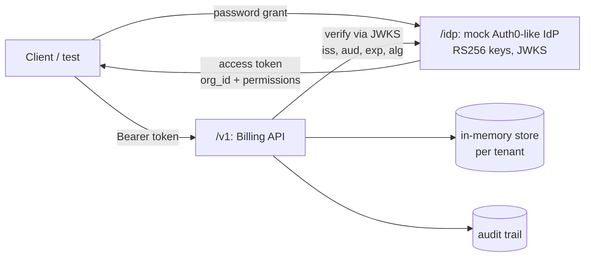

# api-rbac-testing

[](https://github.com/murillovskfilho/api-rbac-testing/actions/workflows/api-tests.yml)

An **API security and authorization testing lab**. A small multi-tenant Billing API with
Auth0-style auth (RS256 JWTs, JWKS, `permissions` claim) is attacked and specified by
**136 Jest tests** and a **Postman/Newman collection**, with a strict OpenAPI contract in between.

The focus is on what usually goes wrong in real APIs: broken object-level authorization, roles
quietly widened, mass assignment, tokens accepted when they shouldn't be, and support tooling
(impersonation) that turns into a backdoor.

## What this demonstrates

| Area | What is tested | Where |
|---|---|---|
| **Authentication** | 12 forged/misconfigured tokens, all refused: expired, `nbf` in the future, wrong `iss`/`aud`, unknown key, unknown `kid`, `alg: none`, **RS256→HS256 algorithm confusion**, payload edited after signing, malformed claims | `tests/authn/`, `tests/support/forged-tokens.ts` |
| **Authorization matrix** | 5 personas × 7 endpoints = 35 cases, from a **hand-written specification table** (not derived from the code, so a widened role fails the build) | `tests/authz/permission-matrix.test.ts` |
| **BOLA / tenant isolation** (OWASP API1) | Cross-tenant access answers **exactly** like a missing id (no existence oracle); property-based with fast-check; idempotency keys scoped per tenant | `tests/security/bola.test.ts` |
| **Mass assignment** (OWASP API3) | 10 server-owned fields rejected on POST and PATCH, nested fields too, nothing changed | `tests/security/mass-assignment.test.ts` |
| **Excessive data exposure** (OWASP API3) | Internal notes and tenant ids never leave the API; no framework header; no stack traces | `tests/security/data-exposure.test.ts` |
| **Support impersonation** | Only with `impersonate:tenants`, read-only, no permission escalation, audited in the impersonated tenant's trail only | `tests/security/impersonation.test.ts` |
| **Business rules** | Money in integer cents, rounding boundaries, **property-based totals against a BigInt oracle** (150 random invoices), state machine, idempotent creation, input validation | `tests/business/invoices.test.ts` |
| **Contract** | Every documented operation and status code validated against a **closed** OpenAPI 3 schema (`additionalProperties: false`) | `tests/contract/`, `openapi/openapi.yaml` |
| **Postman / Newman** | 18 requests over real HTTP: tokens, RBAC, BOLA, impersonation, idempotency, lifecycle. Collection-level rules applied to every response | `postman/` |

## Quick start

```bash
npm ci
npm test                 # 136 Jest tests, in-process (no server needed), ~5s
npm run test:coverage    # ~97% statements / ~94% branches
```

Postman/Newman against a running server:

```bash
npm start                # Billing API on http://localhost:4000
npm run newman           # in another terminal
```

You can also import `postman/billing-api.postman_collection.json` and
`postman/local.postman_environment.json` into Postman and click **Run collection**.

## The system under test



| Role | Permissions |
|---|---|
| `billing_admin` | `read:invoices` `write:invoices` `void:invoices` `read:audit` |
| `billing_clerk` | `read:invoices` `write:invoices` |
| `viewer` | `read:invoices` |
| `support_agent` | `impersonate:tenants` `read:invoices` (via `X-Act-As-Tenant`, read-only) |

Two tenants (`northwind`, `contoso`) plus an internal support tenant. Signing keys are generated at
start-up, so no secret is ever committed. Errors use **RFC 7807** problem documents.

## Design decisions

* **The authorization spec is a table, not code.** `EXPECTED` in the matrix test is written from the
  requirements. Deriving expectations from the app's own role map would make the tests agree with
  any bug. Verified by mutation: giving `viewer` the `write:invoices` permission fails 3 matrix cases.
* **404, never 403, across tenants.** A different status, or even a different error body, for
  "exists but not yours" lets an attacker enumerate ids. The BOLA test compares the cross-tenant
  response with the response for a random id, byte for byte.
* **Attack tokens are generated, not pasted.** Each run forges its tokens against that run's keys,
  so the negative tests can't pass because of a stale fixture.
* **Independent oracles.** Totals are checked against a BigInt implementation written separately
  from the production formula, over random inputs from fast-check.
* **Allow-lists everywhere.** Input is validated against an explicit field list (mass assignment),
  and output is built from an explicit field list (data exposure). The closed OpenAPI schemas
  enforce the same thing from the outside.
* **One fresh app per test file.** No shared state, no cleanup, no ordering coupling, and the whole
  suite runs in about 5 seconds.

## Project layout

```
src/
  domain.ts        roles, users, invoice model, money arithmetic
  idp.ts           mock identity provider: keys, JWKS, password grant
  app.ts           Billing API: auth, RBAC, impersonation, audit, validation
openapi/           OpenAPI 3 contract (closed schemas)
tests/
  authn/  authz/  security/  business/  contract/
  support/         harness (personas, in-process client), forged tokens, OpenAPI matcher
postman/           Newman collection + local environment
```

## License

MIT
